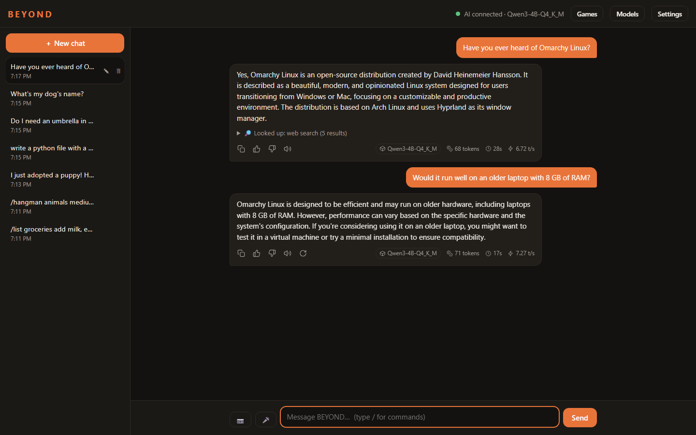
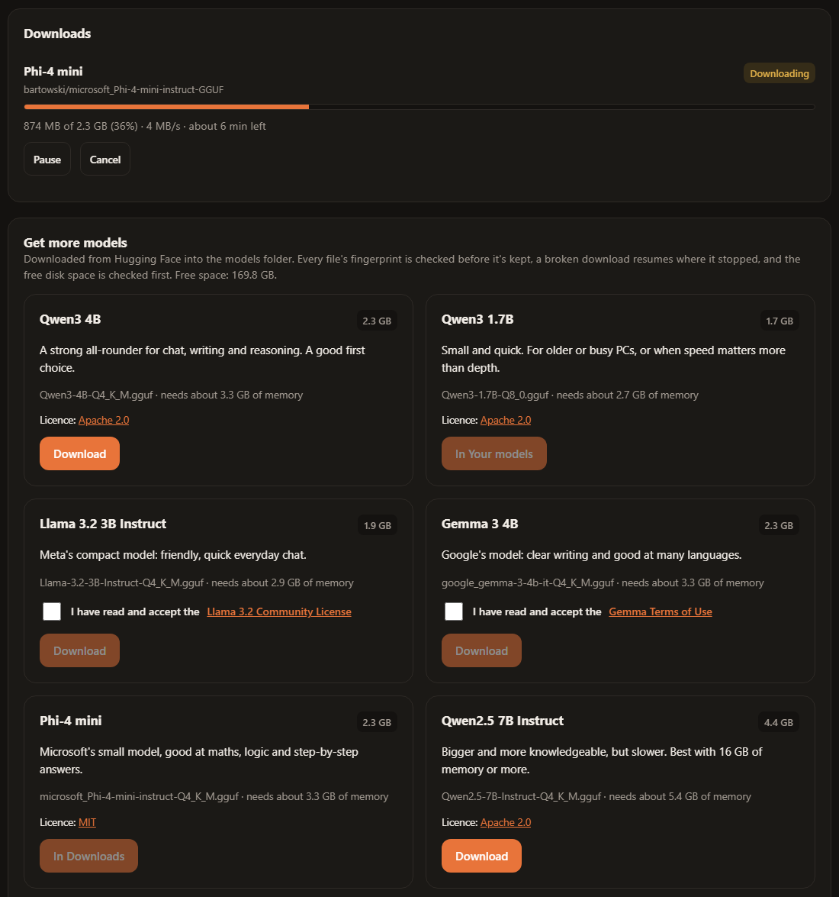
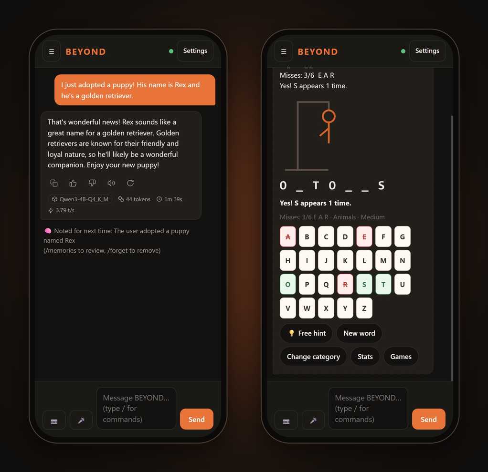
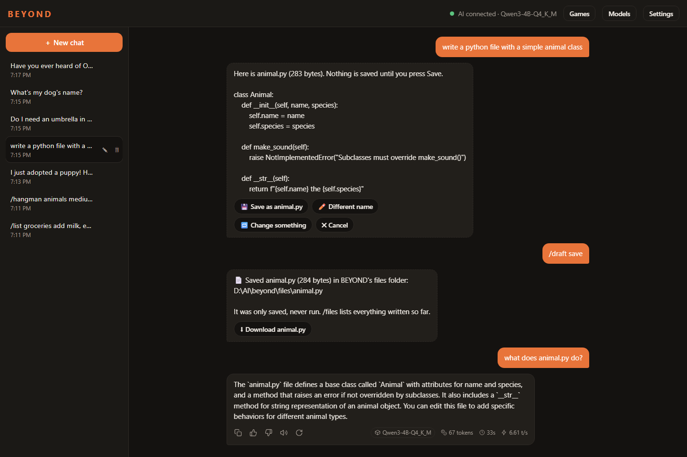
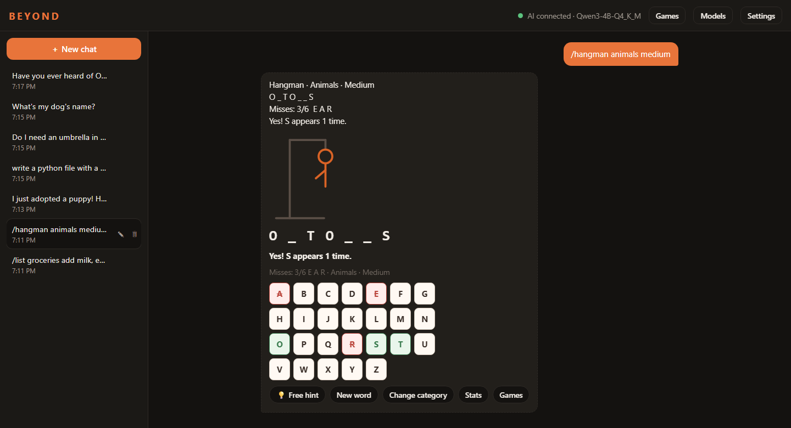
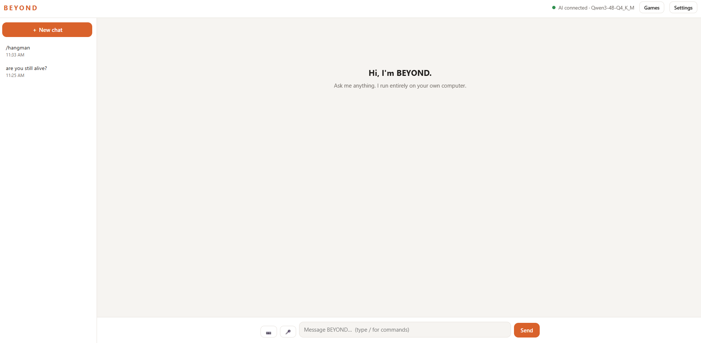
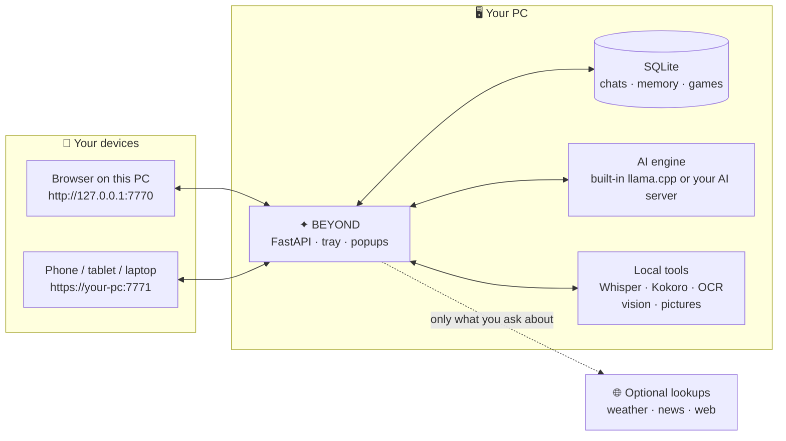

<div align="center">

```
██████╗ ███████╗██╗   ██╗ ██████╗ ███╗   ██╗██████╗
██╔══██╗██╔════╝╚██╗ ██╔╝██╔═══██╗████╗  ██║██╔══██╗
██████╔╝█████╗   ╚████╔╝ ██║   ██║██╔██╗ ██║██║  ██║
██╔══██╗██╔══╝    ╚██╔╝  ██║   ██║██║╚██╗██║██║  ██║
██████╔╝███████╗   ██║   ╚██████╔╝██║ ╚████║██████╔╝
╚═════╝ ╚══════╝   ╚═╝    ╚═════╝ ╚═╝  ╚═══╝╚═════╝
```

### **B**uilt **E**ntirely on **Y**our **O**wn **N**etwork & **D**evice

*A private AI assistant that lives on your own computer. It remembers you, learns how you like answers, looks
things up, keeps you organised, reads photos, listens, talks back and plays games. Your conversations stay on your PC; online lookups and external AI connections use the network.*

---


</div>

Install this assistant from this GitHub repository. The PyPI package named beyond is unrelated.

**Start here:** [User guide](docs/USER_GUIDE.md) · [Third-party notices](THIRD_PARTY_NOTICES.md) · [Setup recovery](planning/setup-recovery.md)


---

<a id="why"></a>
## `▸ WHY BEYOND?`

Running an AI model on your own PC is easy now. Tools like Local AI Studio, LM Studio and Ollama load a model and give
you a chat box. But a chat box isn't an assistant: it forgets you the moment you close it, it can't check the weather,
it can't remind you of anything, and it can't do anything with a photo. The cloud assistants that *can* do those
things want your conversations, your photos and a monthly subscription in return.

**BEYOND** is the missing layer: a full assistant that runs on top of the model you already have, entirely on your
own machine.

| | ☁️ Cloud AI assistants | 🖥️ A bare local model | ✦ **BEYOND** |
|---|---|---|---|
| **Where your data goes** | Their servers | Stays on your PC | **Stays on your PC** |
| **Remembers you across chats** | Yes, on their servers | No | **Yes: facts, preferences, old conversations** |
| **Learns how you like answers** | Opaque | No | **Yes: 👍 👎 ratings and house rules** |
| **Current info (weather, news, web)** | Yes | No | **Yes, and it tells you when it looked** |
| **Reminders, notes, lists, expenses** | Some | No | **Yes, with Windows popups** |
| **Reads and understands photos** | Yes, uploaded | Rarely | **Yes, offline** |
| **Makes pictures** | Yes, uploaded | No | **Yes, on your CPU** |
| **Voice in and out** | Yes, uploaded | No | **Yes, offline** |
| **Use it from your phone** | App + account | No | **Your home network, over HTTPS** |
| **Cost** | Monthly subscription | Free | **Free** |
| **Open source** | No | Varies | **MIT licensed** |

---

<a id="overview"></a>
## `▸ OVERVIEW`

BEYOND is a **Python + FastAPI** web app with a fast, phone-friendly chat page. It runs its **own built-in AI
engine** (llama.cpp, started and looked after by BEYOND), or connects to any **OpenAI-compatible AI server** you
already run (Local AI Studio, LM Studio, Ollama). Around the model it adds everything a
real assistant needs around it: long-term memory, live lookups, an organiser, photo understanding, picture generation,
speech, voice input and games. Every feature runs on the **processor**, so no graphics card is required.

It starts in the **Windows tray**, keeps working when the browser is closed (so reminders and the morning briefing
still arrive), and lets your other devices use it over a **secure address on your home network**.

> **Your AI. Your computer. Your network.** No cloud account, no subscription, no data leaving the house, except the
> weather, news and web lookups you can see it make.

---

<a id="contents"></a>
## `▸ CONTENTS`

<div align="center">

| | | |
|:---:|:---:|:---:|
| [**✦ Features**](#features) | [**▣ Screenshots**](#screenshots) | [**⚙ Tech stack**](#tech-stack) |
| [**⇄ How it works**](#how-it-works) | [**▶ Quick start**](#quick-start) | [**⌘ Commands**](#commands) |
| [**☰ Feature guides**](#guides) | [**⚒ Settings & models**](#settings) | [**⌁ API reference**](#api) |
| [**▤ Project structure**](#structure) | [**⛨ Privacy & security**](#privacy) | [**◷ Roadmap**](#roadmap) |
| [**⇡ Contributing**](#contributing) | [**§ License**](#license) | [**↻ Changelog**](CHANGELOG.md) |

</div>

---

<a id="features"></a>
## `▸ FEATURES`

```
━━ ASSISTANT ━━━━━━━━━━━━━━━━━━━━━━━━━━━━━━━━━━━━━━━━━━━━━━━━━━━━━━━━━━━━━━━━━━
◆  Its own built-in AI engine: pick a .gguf model and BEYOND runs it, no separate server
◆  A phone-friendly Models page: sizes, load/unload/switch and settings saved for each model
◆  Download models from Hugging Face in the app, fingerprint-checked and resumable
◆  Status and health: PC resources, service ports, saved AI speeds and a read-only self-test
◆  Answers stream in as they're written, with Stop, Try again and 👍 👎 ratings
◆  One quiet line under each answer: copy, rate, read aloud, try again, plus model, tokens, time and speed
◆  A short CPU-friendly system prompt, or write and AI-optimize your own in Settings
◆  Choose Normal, Professional, Sarcastic, Evil or Funny in Settings, alongside your house rules
◆  Saved, searchable conversations in a side panel; rename, delete, pick up later
◆  Looks up the weather, news and the web by itself, and shows you exactly what it found
◆  Dated search history survives deleted chats, with Search again and bulk deletion
◆  Follow up on a lookup naturally: “What about Paris?” or “Who directed it?”

━━ MEMORY & LEARNING ━━━━━━━━━━━━━━━━━━━━━━━━━━━━━━━━━━━━━━━━━━━━━━━━━━━━━━━━━━
◆  Remembers facts about you in every chat, ones you tell it and ones it notices
◆  Recalls related older conversations ("what was that movie I told you about?")
◆  Learns from your ratings: shorter, longer, plainer, more careful, whatever you prefer

━━ ORGANISER ━━━━━━━━━━━━━━━━━━━━━━━━━━━━━━━━━━━━━━━━━━━━━━━━━━━━━━━━━━━━━━━━━━
◆  Reminders in plain words, one-off or repeating, with Done and Snooze
◆  A morning briefing: weather, today's reminders, headlines and a quote
◆  Notes with typo-tolerant search · tap-to-check lists · an expense log with CSV export

━━ VISION, PICTURES & VOICE ━━━━━━━━━━━━━━━━━━━━━━━━━━━━━━━━━━━━━━━━━━━━━━━━━━━
◆  Reads the text in photos (OCR) and answers questions about them (vision AI)
◆  Makes pictures from a sentence, with a prompt helper and Quick / Good / Best presets
◆  Speaks its answers aloud (Kokoro, Piper fallback) and understands your voice (Whisper)

━━ GAMES & TOOLS ━━━━━━━━━━━━━━━━━━━━━━━━━━━━━━━━━━━━━━━━━━━━━━━━━━━━━━━━━━━━━
◆  Tic-tac-toe · trivia · an adaptive study quiz · blackjack · hangman · dice
◆  Calculator, unit converter, world clock, dictionary, Wikipedia, movies & TV, QR codes, jokes
◆  Ask for a file in plain words ("write a python file with a simple animal class"): BEYOND asks what's
   missing, drafts it, and saves it when you press Save (or use /writefile); never overwrites, never runs

━━ DESKTOP & DEVICES ━━━━━━━━━━━━━━━━━━━━━━━━━━━━━━━━━━━━━━━━━━━━━━━━━━━━━━━━━
◆  Lives in the Windows tray and can start with Windows
◆  Windows popups for replies, reminders and problems, never while you're watching
◆  Works on phones and tablets over a secure address, with its own trusted certificate
◆  Runs entirely on the CPU: no graphics card, no cloud, no account
```

---

<a id="screenshots"></a>
## `▸ SCREENSHOTS`

<div align="center">



*Asked about something it might not know, BEYOND searches the web first and says so ("🔎 Looked up"). Every answer
ends with a quiet line: copy, rate, read aloud, try again, and the model, tokens, time and speed.*

<br>

<table>
<tr>
<td width="50%" valign="top">
<br><b>Models:</b> recommended models for a processor, downloaded from Hugging Face with fingerprint checks and resume.</td>
<td width="50%" valign="top">
<br><b>On your phone:</b> it remembers what you tell it ("🧠 Noted for next time"), and the games play by touch.</td>
</tr>
<tr>
<td width="50%" valign="top">
<br><b>Files from chat:</b> "write a python file with a simple animal class", check the draft, save it, then ask what it does.</td>
<td width="50%" valign="top">
<br><b>Games:</b> hangman, blackjack, trivia, tic-tac-toe, a study quiz and dice, with saved stats.</td>
</tr>
</table>

<details>
<summary>The welcome screen</summary>

<br>



*Saved chats on the left, the AI connection status, Games and Settings at the top, and the message box with photo
📷 and voice 🎤 buttons.*

</details>

On phones, **Games** and **Models** are in the **☰ menu** beside saved chats. **Settings** stays in the header.

</div>

---

<a id="tech-stack"></a>
## `▸ TECH STACK`

| Layer | Technology |
|---|---|
| **Backend** | Python 3.14 · FastAPI · Uvicorn · Pydantic |
| **AI engine** | Built-in llama.cpp `llama-server` (CPU), or any OpenAI-compatible server: Local AI Studio, LM Studio, Ollama |
| **Storage** | SQLite (WAL) with FTS5 full-text search: chats, memory, notes, lists, expenses, reminders, games |
| **Speech** | Kokoro ONNX · Piper (fallback) · faster-whisper (voice input) · ONNX Runtime |
| **Vision & pictures** | RapidOCR · llama.cpp multimodal (Gemma 3) · stable-diffusion.cpp (DreamShaper) |
| **Online lookups** | httpx · DuckDuckGo · Open-Meteo · Wikipedia · Wiktionary · TVmaze · public news feeds |
| **Desktop** | pystray (tray icon) · Windows-Toasts (popups) · Pillow |
| **Security** | `cryptography`: BEYOND's own name-constrained certificate authority for HTTPS |
| **Frontend** | Hand-written HTML, CSS and JavaScript (no framework, no build step), mobile-first |
| **Platform** | Windows 10 / 11 · CPU only |

<a id="how-it-works"></a>
### How it works



---

<a id="quick-start"></a>
## `▸ QUICK START`

### Automatic text-only setup (Phase 39C)

Download/extract BEYOND, then double-click **Setup.cmd**. Close an already-running BEYOND before continuing.
Setup finds Python 3.14 or offers a verified per-user installation, prepares its isolated environment, installs
the text-only libraries, checks the app starts, and downloads a pinned CPU build of llama.cpp.

Choose **Qwen3 1.7B Q8_0** (1.71 GiB), the smaller **Qwen3 0.6B Q8_0** fallback (610 MiB / 639 MB),
or an existing local GGUF model. Setup recommends from installed RAM, rechecks available memory before testing,
and generates a short reply before saving the configuration. If other apps are using memory, choose **Retry**;
a temporary shortage does not label the computer incompatible. Smaller models and lower context are offered for
memory-related problems. GPU acceleration is not enabled; both bundled recommendations run on the CPU.

Downloads show progress, resume safely when supported, and must match pinned SHA-256 hashes. Python also needs a
valid Python Software Foundation signature. Existing settings are backed up, changed settings are never silently
overwritten, and an existing external AI connection stays selected unless you agree to switch.
Setup stops only its own test engine. It offers a desktop shortcut and opening BEYOND after successful testing.
Logs, hardware details and compatibility results remain locally in `data/setup/`.

For a read-only Python/environment/hardware check, use `Setup.cmd --check`, `py setup.py --check`, or
`powershell.exe -NoProfile -ExecutionPolicy Bypass -File .\setup.ps1 -CheckOnly`.
The PowerShell override applies only to that process. Python 3.8+ can launch setup.py; it then uses Python 3.14.
Advanced users can run `.venv\Scripts\python.exe installer\text_setup.py --model fallback` or
`--model-path "C:\Models\your-model.gguf"` after preparing the environment.

This installs **text chat only**. Add optional features separately below.
Separate-PC installation with existing Python passed. Automatic installation when Python is absent is untested; manually install Python 3.14 x64, then rerun Setup.cmd if that step fails. Manual full-feature installation remains available.

For interrupted downloads, library failures, or an existing environment that needs attention, see the
[setup recovery guide](planning/setup-recovery.md). You can cancel and rerun either installer.

### Your first start (Phase 40)

On a fresh installation, BEYOND opens a **Welcome guide** before chat. It shows installed and available RAM,
keeps the model and connection chosen in Setup, and offers **Keep current**, **Lighter**, or **Balanced**
CPU presets. Your existing AI server keeps its own hardware settings. No downloads or GPU tests run from this page.

Choose **Test my AI** to generate one short greeting. A successful test unlocks **Open chat** for that configuration.
Loading models, occupied engines, connection failures and timeouts explain how to retry. **Set up later** lets you
continue without claiming the test passed. Reopen the guide from Settings whenever you want.

Existing configured installations continue opening chat normally. Welcome progress is local in data/welcome.json;
it does not change chats, memories, network access or optional-feature choices. CPU remains the supported mode;
graphics-card testing and clean-machine acceptance are deferred.

### Add Features (Phase 39D preview)

After the main setup, close BEYOND and double-click **Add-Features.cmd**. Select individual features:

| Feature | Model downloads, excluding missing libraries |
|---|---|
| Voice input: Whisper tiny / base | 75 / 141 MiB |
| Spoken replies: Kokoro CPU int8 | 115 MiB |
| Piper voice, also usable as Kokoro fallback | 115 MiB |
| Photo text recognition: RapidOCR | 30 MiB |
| Photo understanding: Gemma 3 4B + projector | 3.11 GiB, plus CPU engine if missing |
| Image generation: DreamShaper 8 | 1.99 GiB, plus 17 MiB CPU engine |

The installer refreshes hardware information, explains estimated free RAM, shows licenses, installs only selected
packages/files, and tests each feature in its own offline CPU process. Temporary memory shortages offer Retry.
A successful test saves that feature's settings; a failed feature can be retried or skipped while other selections
continue. Test workers and their native children are closed together on cancellation or timeout.

Whisper models and OCR assets are downloaded explicitly. Recording a voice message never starts a model download.
Kokoro and Piper can be installed independently; adding Piper alongside active Kokoro keeps Kokoro selected.
Reruns skip previously verified features when their files, packages and saved settings still match.
Use `--retest` to repair/retest a selection. Existing configurations stay in effect until a replacement test passes.

Examples: `Add-Features.cmd --check` for read-only status, or
`Add-Features.cmd --features whisper kokoro --whisper-model tiny` for selected voice features.
Logs and test outputs stay in `data/setup/optional/`; installation step logs also use `data/setup/install.log`.
Whisper tiny, Kokoro, OCR, vision and image generation were installed and manually tested on a separate PC by Jeremy. Piper passed earlier isolated integration tests; its separate-PC check is unconfirmed. GPU acceleration is not enabled.

### Manual installation

### 1 — Prerequisites

- **Windows 10 or 11** and **Python 3.14**
- A **CPU build of llama.cpp** (`llama-server.exe`) and a **`.gguf` model** for BEYOND's built-in engine, for
  example Qwen3-4B Q4_K_M. Or an **AI server** you already run: Local AI Studio, `llama-server`, LM Studio or Ollama.

### 2 — Clone & install

```powershell
git clone https://github.com/jeremystevens/beyond.git
cd beyond

py -3.14 -m venv .venv
.\.venv\Scripts\python.exe -m pip install -r requirements-lock.txt
```

### 3 — Launch

```powershell
.\.venv\Scripts\pythonw.exe beyond.py
```

BEYOND appears in the **Windows tray** (the orange **B** by the clock). Click it, or open **http://127.0.0.1:7770**.
Prefer a console window? Run `.\.venv\Scripts\python.exe beyond.py --console` instead.

### 4 — Connect your AI

Open **Settings → AI engine**. For the **built-in engine**, choose your `llama-server.exe` and `.gguf` model and
press **Save**: BEYOND starts the engine itself and shows "Engine running" once the model is loaded. Or pick **An AI
server I already run**, enter its address (for example `http://127.0.0.1:10086`) and press **Test connection**. Then
start chatting. Type **/** in the message box to see every command.

### 5 — Check everything works (optional)

```powershell
.\.venv\Scripts\python.exe -m unittest discover -s tests
```

---

<a id="commands"></a>
## `▸ COMMANDS`

Type **/** in the message box for a live, filterable list (arrow keys + Tab or Enter to pick). BEYOND answers commands
itself, instantly, without the AI. A mistyped command gets "Did you mean…?". Commands and their replies are saved in
the chat but never sent to the AI.

### Assistant & memory

| Command | What it does | Example |
|---|---|---|
| `/help` | Every command, or details for one | `/help calc` |
| `/remember` · `/memories` · `/forget` | Save, list and remove facts BEYOND knows in every chat | `/remember my dog is named Max` |
| `/learned` | What BEYOND learned from your ratings, with a reset | `/learned` |
| `/rule` · `/rules` | Add, list and delete house rules | `/rule Use metric units` |
| `/speak` | Read the last answer (or your text) aloud | `/speak` |

### Looking things up

| Command | What it does | Source |
|---|---|---|
| `/web <question>` | Top 5 web results with snippets (alias `/search`) | DuckDuckGo |
| `/weather <place>` | Now, the next 6 hours and 3 days | Open-Meteo |
| `/news [topic]` | Headlines by category or any topic | BBC, NPR, Ars Technica, Google News |
| `/wiki <topic>` | An article's summary | Wikipedia |
| `/define <word>` | Meanings, pronunciation and examples | Wiktionary (Datamuse backup) |
| `/movie <title> [year]` · `/tv <title>` | Cast, ratings and a summary | Wikidata, Wikipedia, TVmaze |
| `/so <question>` | Search Stack Overflow | Stack Exchange |
| `/searchhistory [date, tool or words]` | Recall saved searches; alias `/searches` | Your local lookup history |

### Organiser

| Command | What it does | Example |
|---|---|---|
| `/remind` · `/reminders` | Reminders in plain words, once or repeating; pop up with ✅ Done and 😴 Snooze | `/remind tomorrow at 6pm call Dan` |
| `/morning` | A daily morning briefing at your times | `/morning city San Carlos, CA` |
| `/note` · `/notes` | A notepad with typo-tolerant and date search | `/note find garage` |
| `/list` | Tap-to-check lists for groceries, packing and to-dos | `/list groceries add milk, eggs` |
| `/spent` | An expense log with reports and a CSV download | `/spent 45 gas yesterday` |

### Photos, pictures & tools

| Command | What it does | Example |
|---|---|---|
| `/scan` | Read the printed text in an attached photo, offline | attach a photo, then `/scan` |
| `/look` | Ask the vision AI about an attached photo | `/look what is on the table?` |
| `/imagine <idea>` | Make a picture, with a prompt helper and presets | `/imagine a cartoon cat in space` |
| `/calc` · `/convert` · `/time` | Maths and tips, units, world clock | `/calc tip 85.50 18% split 4` |
| `/qr` | A QR code for a link, text or Wi-Fi (the password stays hidden) | `/qr example.com` |
| `/rewrite` | Rewrite a message in another tone | `/rewrite polite I can't come tomorrow` |
| `/joke` · `/quote` · `/cat` | A joke, a quote, a cat fact | `/joke cats` |

### Files

| Command | What it does | Example |
|---|---|---|
| `/writefile` | Save a new text or code file in BEYOND's `files/` folder, with the contents on the next lines or in your next message. Never overwrites or runs a file; up to 64 KB | `/writefile hello.py` |
| `/files` | The files written so far, with downloads | `/files` |
| `/cancelwrite` | Cancel a /writefile that's waiting for its contents | `/cancelwrite` |
| `/editfile` | Change a file: say what to change, or let BEYOND improve it. Shows the changes before saving | `/editfile animals.py` |
| `/fileundo` | Put back the version from before a file's last edit | `/fileundo animals.py` |
| `/readfile` | Have the AI read a file and explain it, or answer a question about it | `/readfile animals.py what does it do?` |
| `/filehelp` | How to write, edit and read files, with examples (also `/writehelp`) | `/filehelp` |

You can also just ask: **"write a python file with a simple animal class"**. BEYOND asks for anything that's
missing (the kind of file, or what to put in it), has the AI write the contents, and shows them with a suggested
name and **Save**, **Different name**, **Change something** and **Cancel**. Nothing is saved until you choose Save
(or say "save it"). "Save this as hello.py" saves the last answer as it is.

To change a file, ask: **"add a speak method to animals.py"**, or **"improve animals.py"** to let BEYOND use its own
judgement. You see only the changed lines and choose **Save changes**, **Change something else** or **Cancel**; the
old version is kept, and **Undo** (or `/fileundo`) puts it back.

To have the AI read a file, just name it: **"what does animals.py do?"**, "read notes.md", "is there a bug in
animals.py?". It explains the file or answers the question, and the file stays open in that chat for a few
follow-ups ("and what does speak return?").

These need this PC or a device signed in as administrator.

### Games

| Command | What it does | Example |
|---|---|---|
| `/games` | The games menu and shared game stats | `/games stats` |
| `/roll` | Dice and coins: modifiers, keep/drop, advantage, repeats | `/roll 2d20+3` |
| `/tictactoe` | Easy, Normal or Impossible (never loses) | `/ttt impossible` |
| `/trivia` | Five-question rounds by category and difficulty | `/trivia science hard` |
| `/quizme` | A study quiz that adapts to you | `/quizme 7 times table` |
| `/blackjack` | Hit or Stand against the dealer | `/bj` |
| `/hangman` | Guess the word before the drawing is complete | `/hangman animals medium` |

---

<a id="guides"></a>
## `▸ FEATURE GUIDES`

*Click a section to open it.*

Health commands: **/speed** (or **/speed 1–50**) shows saved reply timings; **/selftest** runs read-only checks.
Both appear in **/help** and the **/** command menu. Open **Settings → Status and health** for the full page.

<details>
<summary><b>⚡ The built-in AI engine</b></summary>

<br>

With **Settings → AI engine → BEYOND's built-in engine**, BEYOND runs llama.cpp's `llama-server.exe` itself. Choose
a **CPU build** of `llama-server.exe` and a **`.gguf` model** (for example Qwen3-4B Q4_K_M), press **Save**, and
BEYOND:

- starts the engine on a **free port only this PC can reach**, waits until the model is loaded, then pre-reads the
  stable chat prompt before showing Ready. This moves most of the cold first-reply prompt cost into startup
  (loading and preparation can take a few minutes from a hard disk);
- runs it **on the processor only**, tuned for that: 12 threads, an 8192-token context, an f16 cache and one
  conversation slot, so the start of the prompt stays cached and follow-up answers begin faster;
- answers straight away with **thinking models** such as Qwen3: their thinking is switched off unless you turn on
  **Let thinking models think first**. Then the answer bubble shows **💭 Thinking… 12s** while it thinks, but the
  thinking itself is never shown;
- **restarts it** with new settings when you save them, and by itself if it stops (three tries, then
  **Restart engine** in Settings), with a popup when it goes down;
- **closes it** when BEYOND quits, and stops an engine left behind by a crash the next time it starts.

Under every answer one quiet line holds small outline icons on the left (Copy, 👍, 👎, Read aloud, Try again) and
the stats on the right: the model, the thinking time (thinking models), the tokens written, the total time and the
writing speed, e.g. `Qwen3-4B-Q4_K_M · 77 tokens · 36s · 2.10 t/s`. Hover over any of them for what it means.

The engine stays loaded for as long as BEYOND runs, so it's always ready. Threads, context size, cache type (f16,
q8_0 or q4_0) and thinking are all in Settings. The engine's own messages go to `data\engine.log`. Prefer an AI server
you already run? Choose **An AI server I already run** instead: setups made before the built-in engine keep using
their server.

</details>

<details>
<summary><b>💬 Chats, personality and house rules</b></summary>

<br>

Every conversation is saved on your PC as you go, in `data\beyond.sqlite3`. The panel on the left lists them, newest
first: click one to open it, **✎** to rename it, **🗑** to delete it, **＋ New chat** to start another. A new chat is
named after its first message. Refreshing the page or restarting BEYOND keeps your chats, and the page reopens the chat
you were in. If you press Stop, what the AI wrote so far is saved and marked "Stopped".

**Personality.** BEYOND's optimized default lives in `app/personality.md`. It is 257 words, with a 69-word app
contract added by Python for tool honesty and safety. Detailed tool notes are attached only when the current question
needs them instead of being repeated in every chat. You can use the default, write your own prompt, or ask the loaded
AI to improve a draft in Settings. Changes apply from the next reply.

**Fast replies.** Each question is sent with up to the last 12 messages. The stable prompt always comes first and the
history grows from 6 to 12 messages before it is cut back in one step, so the AI server can reuse what it already read.
The new 326-word default and app contract are about 85% shorter than the previous base prompt before memories and house
rules. The built-in engine now pre-reads that stable prompt once after loading, before it reports Ready. A changed
prompt, memories or house rules can still require new processing, and no fixed response time is promised.

**House rules** are instructions BEYOND follows in every chat, such as "Always answer in under 3 sentences" or
"Always answer in French" (up to 25). Use **/rule**, **/rules**, **/rule delete &lt;number&gt;**, or the House rules
section in Settings. Rules are also repeated next to your newest message, because small models follow instructions
best when they're close to the question.

**Phones and tablets.** On a phone the chat list slides in from **☰**, the header and message box stay on screen (also
with the keyboard open), buttons are thumb-sized, and the layout leaves room for the notch and home bar.

</details>

<details>
<summary><b>↪ Natural follow-ups after a lookup</b></summary>

<br>

You can continue a lookup without repeating the slash command or its subject. Context belongs to the **current
chat**, works on phones and computers, and stays saved across a page refresh or app restart.

| Start with | Follow up with | What happens |
|---|---|---|
| `/weather London` | “What about Paris?” | Runs a fresh weather lookup for Paris. |
| `/weather London` | “Will it rain there tomorrow?” | Runs a fresh London forecast and shows tomorrow's line. |
| `/weather London` | “What about Paris tomorrow?” | Looks up Paris and shows tomorrow's forecast. |
| `/movie Alien` | “Who directed it?” | Reads the director from that lookup and names its source. |
| `/movie Alien` | “Who stars in it?” or “How long is it?” | Reads available cast/runtime information for the resolved film. |
| `/wiki Apollo 11` | “What about Apollo 13?” | Looks up Apollo 13 on Wikipedia. |
| `/define elated` | “What about jubilant?” | Looks up the new word. |
| `/news tech` | “What about science?” | Fetches the new news topic. |
| A web or Stack Overflow search | “Search again” | Repeats the original lookup with fresh results. |

Explicit web requests also work in ordinary conversation: “search the web for Omarchy Linux” runs the same tool
as `/web Omarchy Linux`. After “Have you ever heard of Omarchy Linux?”, “If you don't know you could always look it up”
or “yes please look it up for me” searches that subject from the current chat. Polite prefixes and “for me” are accepted. This does not require
a previous successful lookup. If no clear subject exists, BEYOND asks what to search. Explicit search requests work
even when automatic lookups are off, just like slash commands; results are recorded once in search history.

With automatic lookups enabled, you can also ask for weather in ordinary conversation. If you say “I meant
the weather”, BEYOND asks for the city; “Franklin, Tennessee” in your next message runs the lookup. A short
confirmation can finish an unresolved weather request using the location you just supplied. This uses recent
user messages in the same chat, never an AI promise or another chat. A missing comma before a US state is
handled by the shared place finder too: “Denver Colorado” or “Denver CO” works in chat, `/weather` and `/time`. A completed lookup is not repeated just
because you say thanks or agree. Turn automatic lookups off in Settings to keep using explicit commands.

An unfinished weather request stays saved in this chat while BEYOND waits for a location or confirmation.
A close US state typo such as “how about franklin tennese” offers **Did you mean franklin, Tennessee?** with a
**Yes, check this location** button. With automatic lookups on, replying “yes thats what i want!!” also runs
that weather lookup. The geocoder validates the confirmed place and supplies its coordinates; the spelling
suggestion itself is not a search and does not enter search history. Other city spelling errors may still
need clarification. Pending requests survive restarts, stay within their chat, and end after a new topic.

Clear “What about…”, “How about…” and “And…” comparisons reuse weather, news, Wikipedia, dictionary, movie or TV
tools. A web/Stack Overflow comparison offers a choice: search the new topic alone, or include the previous
query. It does not guess which interpretation you intended.

Film/TV fact follow-ups include director, cast, runtime, release/start year, ratings and plot when those fields
are available. Answers identify the resolved title and label their information as coming from the previous
lookup. Missing details are not invented: Refresh lookup and Search the web are offered. For a TV-series
director question, BEYOND asks whether you mean its creators or a particular episode.

Other short references, such as “Is it scary?”, can pass bounded source data and the resolved subject to the
chat AI. They require a loaded model, whereas direct field answers and tool comparisons do not. Cached results
are not labelled as a new search. “Search again” explicitly refreshes the source.

A clear new conversation topic or an unrelated slash command ends the old lookup context. A short “Thanks”
does not. New chats never borrow another chat's subject, and a failed new lookup clears the old context.
Chat deletion removes its context. **Search history** remains independent: fresh lookups are recorded once,
while reading a fact already in the result does not add another history record. Repeats opened from the
Search history page also establish context in their new chat.

</details>

<details>
<summary><b>🔎 Search history: find and repeat old lookups</b></summary>

<br>

Open **Settings → Search history** on your phone or computer. History starts with version **0.34.2**; old deleted
chats cannot be reconstructed. Each new lookup keeps its canonical tool and query, UTC timestamp, local time
and timezone, manual/automatic label, result status, a short saved snapshot and source links.

**Included:** `/web` (`/search`), `/wiki`, `/weather`, `/news`, `/so` (`/stackoverflow`), `/define`,
`/movie` (`/film`) and `/tv`, plus automatic web/weather/news lookups. Failed and empty-result attempts are
labelled so they can be retried. Bare commands that only show usage are not saved. Jokes, quotes, cat facts,
games and other generated content are excluded.

In chat, use:

- `/searchhistory` or `/searches` for recent lookups.
- `/searchhistory last Thursday` or `/searchhistory web Oct 18` to filter by date and tool.
- `/searchhistory python` to find words in the saved query or snapshot.
- “What did I search for last Thursday?” or “What was the web search I did on Oct 18?” for direct recall.

Supported dates include today, yesterday, weekdays, last/this week, last/this month, `Oct 18, 2026` and
`2026-10-18`. An omitted year uses the most recent occurrence of that date. Date filters use the PC's timezone;
records retain the timezone and offset used when they ran. Chat shows five matching records at a time, with
**More searches** when needed. Lookup history is read by Python, not invented by the AI, and recalling it works
without a model loaded or an internet connection.

**Search again** performs the same tool/query lookup against the live service and saves a new, dated entry.
From chat it runs in the current conversation; from the history page it opens the new result in a new chat.
Saved snapshots are historical results, not current facts.

The history page has text, tool, date-range and manual/automatic filters. Tick individual entries or **Select
all shown** (up to 25 on a page), uncheck anything to keep, then **Delete selected** and confirm. Only those IDs
are deleted. Deleting a chat does not remove history; deleting history does not remove saved chats or copies
of results already in them. The page works on phones, including wrapping queries, large controls and stacked
filters on narrow screens.

Records live in the `lookup_history` table in local, git-ignored `data/beyond.sqlite3`, with no chat-delete
relationship. Snapshots are limited to 1,800 characters and eight source links. History is not appended to
every AI prompt and has no automatic expiration; remove unwanted records from the history page.

</details>

<details>
<summary><b>🧠 Memory: saved facts and recall</b></summary>

<br>

- **/remember &lt;fact&gt;** saves a fact for every chat; **/memories** lists them with a 🗑 for each; **/forget**
  removes one or all. Up to 40 facts of 200 characters. The same fact worded differently is recognised, and BEYOND
  never saves passwords, PINs, codes, or card or account numbers. Newer facts win over older ones that conflict.
- **Noticing facts.** Mention something lasting about yourself in passing ("I'm a nurse and I have a cat named Luna",
  "I just got a new dog named Rex", "Started a new job at Tesla today") and BEYOND saves it after the answer, showing
  **🧠 Noted for next time**. It only runs after personal-sounding messages and never while another answer is being
  written. Turn it off with **/memories auto off** or in Settings.
- **Recalling old conversations.** Every message is indexed for search (SQLite FTS5). Ask "what was that movie I told
  you about?" and BEYOND finds the most related earlier exchanges in any chat and gives them to the AI as background.

</details>

<details>
<summary><b>👍 Ratings and learning</b></summary>

<br>

Every answer has **👍**, **👎** and **🔄 Try again** under it.

- **👎** asks what was wrong (too long, too short, wrong or made up, not helpful, wrong tone, didn't understand). After
  the same kind of complaint twice, BEYOND changes how it answers: shorter (with a firm word limit), more detail, extra
  care with facts, or a plainer tone. **👍** slowly undoes old complaints.
- Ask something similar to an answer you rated, and the AI sees the one you liked as a guide and the one you didn't as a
  mistake to avoid.
- **🔄 Try again** writes a different answer to your last question; the old one stays, marked "Tried again below".
- **/learned** shows what BEYOND picked up, with **🧽 Reset what you learned**. The model itself isn't retrained;
  ratings change what it's told before it answers.

</details>

<details>
<summary><b>🔎 Live lookups: weather, news and the web</b></summary>

<br>

The lookup commands (see [Commands](#commands)) use free public services with no accounts or API keys. Only what you
type after the command is sent, and without internet each one says so plainly.

**Automatic lookups.** For everyday questions you don't need the commands. When a message clearly needs current
information, BEYOND looks it up first and the AI answers from the results:

- weather words and a place ("do I need an umbrella in London tomorrow?") → Open-Meteo;
- "latest news about…", "any breaking news?" → the news feeds;
- other current questions ("who won … this year?", "price of…") → web search.

The page shows "🔎 Checking the weather for Paris…" while it looks, and the answer ends with **🔎 Looked up: …**; tap it
to see exactly what was found. That line is added by BEYOND, never by the AI. The decision is made by quick checks in
Python (no extra AI work). Turn it off in Settings; the AI then says it can't check and suggests the command.

</details>

<details>
<summary><b>📅 Organiser: reminders, morning briefing, notes, lists and expenses</b></summary>

<br>

- **Reminders.** `/remind 30m stretch`, `/remind tomorrow at 6pm call Dan`, `/remind every weekday at 7am stand-up`,
  `/remind every month on the 1st pay rent`. They pop up in the chat where you set them with ✅ Done, 😴 10 min and
  😴 1 hour, plus a Windows popup. In another chat, a ⏰ banner offers to open it. `/reminders` lists and cancels them.
- **Morning briefing.** `/morning` opens a menu: weekday and weekend times, your city, sections (weather with umbrella
  and jacket tips, today's reminders, three headlines, a quote or a joke). It arrives in its chat with a popup, even
  with the browser closed.
- **Notes.** `/note garage key is in the blue folder`; `/note find garage` (typos and "yesterday" or "last week" are
  fine); ↩️ Undo after saving, 🗑 per note, and a confirmation before clearing all. Passwords and codes are refused.
- **Lists.** `/list groceries add milk, eggs, bread`: tap an item to check it off, 🧹 clear checked items, 🗑 delete a
  list. "groceries" and "my grocery list" are the same list.
- **Expenses.** `/spent 12.50 lunch`, `/spent 45 gas yesterday`; categories are picked from the words and remembered
  when you choose one. `/spent`, `/spent last month`, `/spent year` and `/spent all` show reports with totals,
  averages and comparisons, each with a 📄 **Download CSV** button that opens in Excel.

</details>

<details>
<summary><b>📷 Photos: text scanning and photo understanding</b></summary>

<br>

Attach a **PNG, JPEG or WebP** with the 📷 button, or drop one onto the chat (up to 10 MB / 25 megapixels).

- **Read text / `/scan`** uses **RapidOCR** on the CPU, offline. The result has a **Copy text** button. Printed text
  works best. Only one scan runs at a time.
- **Describe it, Receipt / totals or your own question (`/look`)** asks a separate **CPU vision process** (Gemma 3
  via llama.cpp) at background priority. Allow about 1–2 minutes; you can keep chatting or close the browser, and a
  popup opens the chat when it's done.
- Set up `/look` on the host PC in **Settings → Photo understanding**: a CPU `llama-mtmd-cli.exe`, a Gemma 3 vision
  `.gguf` and its matching `mmproj` projector.
- Photos and answers stay on this PC, saved in their chat with metadata stripped. Deleting the chat removes them.

</details>

<details>
<summary><b>🎨 Picture generation</b></summary>

<br>

Type **/imagine &lt;picture idea&gt;**, optionally choose **Improve prompt** (your chat AI writes a more detailed
description that you can review, edit or undo), then pick a preset:

| Preset | Size | Steps | Approximate CPU time |
|---|---|---|---|
| Quick | 256 × 256 | 8 | 1–2 minutes |
| Good | 384 × 384 | 12 | 3–5 minutes |
| Best | 512 × 512 | 15 | 9–12 minutes |

One picture runs at a time in its own CPU process at below-normal priority, so chat keeps working. The result replaces
its progress message, with a **Download PNG** button and a popup preview. Common defects (blur, watermarks, extra
fingers, distorted anatomy) are avoided automatically; unwanted text is avoided unless you ask for lettering.

Set it up on the host PC in **Settings → Picture generation**: `sd-cli.exe` from its CPU folder and a DreamShaper
`.safetensors` model.

</details>

<details>
<summary><b>🔊 Spoken replies and 🎤 voice input</b></summary>

<br>

**Spoken replies.** `/speak` reads the last answer; the **Read aloud** (speaker) icon under an answer does the same; **Read answers
aloud automatically** is optional in Settings. Speech uses **Kokoro** (Piper as fallback) in a separate CPU process,
one clip at a time. Clips are saved with the answer and play in an audio player with seek controls.

**Voice input.** Install Whisper tiny or base with **Add-Features.cmd**, then tap **🎤**, speak, and tap **⏹**.
Your words are turned into text **on this PC** (faster-whisper, CPU) and sent like a typed message. The recording
is deleted straight away. The selected local model works offline; recording never triggers a download. Older
installations can still reuse an already-cached base model. Browsers only allow the microphone on secure pages,
so on other devices use BEYOND's `https://` address (see [Privacy & security](#privacy)).

</details>

<details>
<summary><b>🎮 Games</b></summary>

<br>

Open **Games** in the header or type **/games**. Every game saves its state, survives reloads and restarts, stays in
sync across devices, and counts once in the shared **/games stats**.

- **Dice & coins.** `/roll`, `/roll 2d20+3`, `/roll 4d6kh3`, `/roll adv+5`, `/roll 6x 4d6kh3`, `/roll coin`, with
  visual dice and **Roll again**.
- **Tic-tac-toe.** A clickable 3×3 board. **Easy** plays randomly, **Normal** takes wins and blocks, **Impossible**
  uses minimax and never loses.
- **Trivia.** Five-question rounds by category and difficulty from Open Trivia DB (The Trivia API as fallback);
  Easy/Medium/Hard answers earn 1/2/3 points, with streaks. Each question shows its source and licence.
- **Study quiz.** `/quizme multiplication`, `/quizme 7 times table` or any topic (questions written by your AI). Four
  answer buttons, worked explanations, and levels 1–5 that adapt as you go.
- **Blackjack.** Hit or Stand on a card table; the dealer draws to 17. The face-down card and the deck never reach the
  page.
- **Hangman.** Pick a category and difficulty, then guess on an on-screen keyboard (or by typing) while the gallows
  drawing fills in. One free hint per round; the secret word stays on the server.

</details>

<details>
<summary><b>🖥️ Tray icon, popups and start with Windows</b></summary>

<br>

BEYOND runs from the **Windows tray**: **Open BEYOND**, **Pause popups** and **Quit BEYOND**. It keeps running when the
browser is closed, and what it prints goes to `data\beyond.log`.

**Windows popups** tell you when the AI has replied, when a reminder goes off (with ✅ Done and 😴 Snooze on the popup),
and when something went wrong, but only while you're not looking at BEYOND's page. Clicking one opens that chat. Each
kind can be switched off, with quiet hours and a **Send a test popup** button. **Start BEYOND with Windows** adds it to
your user's startup programs.

</details>

---

<a id="settings"></a>
## `▸ SETTINGS`

Click **Settings** at the top of the chat page (or open `http://127.0.0.1:7770/settings`). It's grouped with the
most-changed settings first, with jump links at the top: AI engine and models, Chat and everyday use, Popups and
startup, Photos and pictures, then Address and network. Engine paths, network and
other general settings can only be changed on the PC BEYOND runs on. **Chat prompt**, **Persona** and
**House rules** can also be changed from your phone or another home-network device. The Models page lets those
devices select and tune models already added on the PC.

| Setting | What it does |
|---|---|
| **Chat prompt** | [Use the optimized default or write and AI-improve your own](#chat-prompt). |
| **Persona** | [Optional speaking styles](#persona), off by default. Enable Use a persona to apply one. |
| **AI engine** | BEYOND's built-in engine (`llama-server.exe` + a `.gguf` model, threads, context, cache, thinking) or an AI server you already run. |
| **Models** | [Load, unload or switch models](#models), with CPU threads, context, cache and thinking saved per model. |
| **Status and health** | [PC resources, ports, saved reply speeds, recent errors and self-test](#status-health); available on phones. |
| **AI server** | The address of your OpenAI-compatible AI server, with **Test connection**. Takes effect at once. |
| **House rules** | Add and remove the rules BEYOND follows in every chat. |
| **Search history** | Browse dated lookup snapshots, filter them, search again or bulk-delete selected records; also available on phones. |
| **Memory** | Notice facts automatically · search older conversations. |
| **Looking things up** | Automatic weather, news and web lookups. |
| **Photos, pictures & speech** | Paths and options for `/look`, `/imagine` and spoken replies. |
| **Popups & tray** | Popups per kind, quiet hours, a test popup, **Start BEYOND with Windows**. |
| **Port** | 7770 by default; ports other AI apps rely on, and ports already in use, are refused. |
| **Allow other devices** | Off by default. When on, BEYOND lists its addresses and offers its certificate. |
| **Sign-in** | Require other devices to sign in (on by default; switch it off if only you use your network), the sign-in password, a separate administrator password that lets another device change settings like this PC, and the signed-in devices with Sign out. This PC never signs in. |

<a id="chat-prompt"></a>
### Chat prompt

<details>
<summary><b>Use the optimized default or write your own system prompt</b></summary>

<br>

The optimized default is active on a fresh install. Its 257-word personality plus the 69-word app contract gives the
model its role, answer style, tool boundaries and honesty rules without making a CPU model reread a feature manual.
Relevant tool details are added only to turns that need them. Saved memories and house rules are still included.

The editor shows the optimized default on a fresh install, so it also serves as a starting example. To use your own
instructions, open **Settings → Chat prompt**, enable **Use my own prompt**, edit the text and press **Save prompt**.
The main Settings **Save** button includes it too. The word and character counter helps keep it short;
prompts can be up to 16,000 characters, but a longer prompt takes the model longer to read. Changes apply to the next
reply without restarting BEYOND or reloading the model.

**Improve & optimize** sends the editor text to the currently loaded chat model with a one-off request to preserve the
role, tone, language and important constraints while removing repetition and aiming for 250 words or fewer. It shows
elapsed progress and refuses to queue while the AI is busy. The result is an **unsaved draft**: review it, edit it, use
**Undo AI changes** if needed, then press **Save prompt**. If the editor is empty, the optimized default is used as the
draft. The helper does not change chats, memories, house rules or saved settings by itself.

**Use optimized default** turns the custom prompt off but keeps its text for later. **Reset to defaults** turns it off
and clears the saved custom text. Python always adds the short app contract, so a custom prompt cannot grant tools or
actions BEYOND does not have. The responsive editor and its narrow save endpoint work from phones and computers.

</details>

<a id="persona"></a>
### Persona

<details>
<summary><b>Choose BEYOND's speaking style</b></summary>

<br>

**Personas are off by default.** Leave **Settings → Persona → Use a persona** unchecked and press
**Save persona** to disable optional role instructions. The selected preset stays saved for later, but does
not enter chat prompts while the switch is off. BEYOND's standard personality, house rules and memories remain.

To opt in, enable **Use a persona**, choose a style and press **Save persona**. That button saves just this choice,
so it does not apply unfinished edits elsewhere on the page. The main **Save** button also includes it when
saving all settings from the host PC.

| Persona | Style |
|---|---|
| **Normal** | BEYOND's usual friendly, witty and helpful personality; the default. |
| **Professional** | Clear, polished, calm and businesslike. |
| **Sarcastic** | Dry wit and affectionate, playful sarcasm. |
| **Evil** | Fictional supervillain flair: dramatic, mischievous and playfully ominous. |
| **Funny** | More jokes, amusing comparisons and lighthearted observations. |

When enabled, the choice adds a short role instruction to the chat system prompt. House rules, saved memories, factual
accuracy and BEYOND's actual capabilities still apply. Normal uses the existing personality without an extra
role block. The selected persona applies to the **next AI reply** in existing and new chats, across devices.
An answer already being written keeps its current instructions.

The choice is saved locally in `data/settings.json` and survives app restarts. Switching persona does not restart
BEYOND, reload the model or rewrite old answers. One-off jobs such as memory extraction, the study quiz and
picture-prompt improvement keep their own task instructions. **Reset to defaults** turns personas off and returns the preset to Normal.
Persona changes are available on phones as well as on the PC running BEYOND.

Turning personas off does not remove the base system prompt. Normal already adds no extra role block.
A slow first answer followed by faster replies can come from processing a fresh prompt and reusing it on later
turns; disabling an already-empty Normal role block does not establish a speed improvement. Check engine logs
and compare first replies separately from later replies. No automated AI benchmark was run for this change.

</details>

<a id="status-health"></a>
### Status and health

<details>
<summary><b>Check this PC, AI speeds and connections</b></summary>

<br>

Open **Settings → Status and health**, or visit `/status`. The page uses the same light/dark theme as chat and
stacks cards on phones. It shows this PC's CPU load, available memory, free space on BEYOND's drive, model state
and how long BEYOND has been running. Available memory below 1 GiB is flagged as a warning on the page,
in self-test and in diagnosis evidence; Diagnose also shows a separate warning alongside any AI explanation. Auto-refresh runs every 10 seconds while the page is visible and can be paused.

**Services and ports** checks only the web, secure-web and configured AI endpoints that BEYOND actually uses. It
shows their port numbers, response time and status. Disabled HTTPS and an intentionally unloaded model are labelled
as such. External AI servers use their configured address. Photo, image and speech workers do not open listening ports.

**AI speed history** reads the last 30 saved answer timings, with a writing-speed graph and averages separated by
model. It does not ask the AI to generate a benchmark. **/speed** shows 10 recent replies in chat; **/speed 25**
changes that count (1–50). Writing speed excludes prompt processing; total reply time includes it. Different models,
answer lengths, cached prompts and other work on the PC affect comparisons.

**Run self-test** or **/selftest** checks the service endpoints, settings JSON, SQLite integrity, free disk space and
enabled optional model files. It uses existing files and small HTTP requests only: it does not load a model, produce
an AI answer, install dependencies, download anything, change settings or restart services. Passed, failed, review
and skipped checks have separate labels. A second simultaneous self-test is refused until the first finishes.

**Recent errors** keeps up to 200 fixed app error summaries in `data/diagnostics.sqlite3`, newest first, across
restarts. The page shows the latest 30. History begins with this update; it does not import old logs or expose chat
text, credentials, raw exception messages or stack traces. Chat/engine failures and logged application errors are
captured; the host PC's existing logs remain the place for full debugging details. Monitoring stays within BEYOND,
so it can report a crashed AI engine while BEYOND is running, but cannot serve a page while BEYOND itself is stopped.

Press **Diagnose** beside an error to gather fresh health evidence and ask the loaded AI to explain likely causes,
what the evidence supports and steps to try. One diagnosis runs at a time, with a progress message. If the AI is
busy, unavailable, times out or fails, basic troubleshooting is shown instead. No model is loaded automatically.
The AI sees only the selected fixed error summary, current resource/service checks and a few feature switches;
chat history, custom prompts, credentials, file paths and raw logs are excluded. The configured AI server is used,
including an external server if that is your setup. Explanations are suggestions, not confirmed causes: today's
health cannot prove what happened earlier. No settings or services are changed.

**Add test error** creates one clearly labelled simulated AI timeout without breaking a service. Press **Diagnose**
on that entry to try the feature. **Clear test errors** removes only simulated entries, keeping real error history.
Diagnosis results stay on the open page and are not saved as chat messages.


</details>

<a id="models"></a>
### Models

<details>
<summary><b>Choose a model, switch it and save its settings</b></summary>

<br>

Open **Models** in the chat header on a computer, or in the **☰ menu** on a phone. It is also linked from
Settings, or visit `/models`. On phones, **Games** is in the same menu, leaving **Settings** in a single-row header.
The page uses two columns on wider screens and stacked model cards on phones, with wrapping file names and
paths and large touch controls. It uses the same light/dark theme and safe-area/keyboard layout as chat.

- Put chat `.gguf` files in BEYOND's `models` folder (subfolders work), then **Refresh list**. Sizes are shown in
  binary units. Split GGUF models appear once, with their combined size; all parts must be present. Vision
  projectors (`mmproj`) are left out of this chat list.
- Your existing Phase 33 model appears automatically. **Add a model from this PC** can also register an existing
  GGUF by full path, without copying or moving it. Adding paths and choosing the engine executable are available
  on the PC running BEYOND; phone users can load and tune the listed models.
- **Load model** or **Switch model** selects BEYOND's built-in engine, frees the previous model and loads the chosen
  one. The page updates while loading and says **Ready to chat** only after the matching engine passes its health
  check. The next AI reply uses that model, in an existing or new chat. Existing answers keep their original stats.
- **Unload model** frees the built-in model's memory and keeps it unloaded, including after restarting BEYOND,
  until you load one again. Local commands and saved chats still work.
- Expand **Model settings** to save CPU threads, context size, cache type and thinking separately for each model.
  Saving the loaded model's settings reloads it. Settings for other models apply when you load them. The same
  values stay in sync with the existing Settings page.
- Model changes are refused while the AI is answering or completing a background request. Finish the answer or
  press **Stop** in chat first. You can cancel a slow model load with **Unload model**, or choose another model.
- Weights stay on disk when you unload; this page never deletes or copies them. The models folder is
  git-ignored. Profiles and the selected/unloaded state stay in local `data/settings.json`.
- **Get more models** downloads from Hugging Face: pick a recommended model, or paste any model's link (or
  `owner/name`), press **Look up** and choose a file (Q4_K_M is a good size for a processor). Each file's SHA-256
  fingerprint must match before it's kept. A broken download resumes where it stopped, **Pause** and **Resume**
  work any time, and the free disk space is checked first. Models whose licence asks you to accept the maker's
  terms need the tick box; gated ones that need a Hugging Face sign-in are linked instead. When it's done, press
  **Load now**. Downloads are started on the PC BEYOND runs on; other devices can watch the progress.

</details>

Your changes live in `data\settings.json` (only what differs from the defaults in `app/config.py`). The whole `data`
folder is git-ignored, and **Reset to defaults** brings back a fresh install's settings.

---

<a id="api"></a>
## `▸ API REFERENCE`

BEYOND's page talks to a small JSON API, which you can use from scripts too.

<details>
<summary><b>Show all endpoints</b></summary>

<br>

**Chat**

| Method | Endpoint | Description |
|---|---|---|
| `POST` | `/api/chat/stream` | Send a message or command; the reply streams back as JSON lines |
| `POST` | `/api/chat` | One-shot reply without saving (for scripts) |
| `GET` | `/api/chats` | List saved chats |
| `GET` · `PATCH` · `DELETE` | `/api/chats/{id}` | Open, rename or delete a chat |
| `POST` | `/api/messages/{id}/press` | Press a button under a message |
| `POST` | `/api/messages/{id}/retry` | 🔄 Try again on the newest answer |
| `GET` | `/api/commands` | The command list behind the **/** menu |
| `GET` | `/api/search-history` | Saved lookups; query, tool, start/end dates, origin and pagination filters |
| `POST` | `/api/search-history/delete` | Delete only supplied history IDs (`{"ids":[1,2]}`); 1–100 per request |
| `POST` | `/api/search-history/{id}/repeat` | Run a saved lookup again and open the result in a new chat |

**Status, settings & rules**

| Method | Endpoint | Description |
|---|---|---|
| `GET` | `/api/health` | BEYOND's version, phase and secure port |
| `GET` · `POST` | `/login` · `/api/login` · `/api/logout` | Sign in or out on another device |
| `GET` | `/api/auth/state` | Whether this device is signed in and a password is set |
| `GET` · `POST` | `/api/auth` · `/api/auth/password` · `…/remove` · `…/sign-out-device` · `…/sign-out-all` | The password and signed-in devices (this PC only) |
| `GET` | `/api/ai-status` | Whether the AI server is reachable, and its model |
| `GET` | `/api/status` | PC resources, model state and configured service/port checks |
| `GET` | `/api/status/speed` | Saved reply timings and averages by model; `limit=1–50` |
| `GET` | `/api/status/errors` | Bounded app error summaries; `limit=1–200` |
| `POST` | `/api/status/selftest` | Read-only connection, settings, SQLite and file checks; 409 while busy |
| `POST` | `/api/status/errors/{id}/diagnose` | Explain a retained error with current health evidence; AI or basic fallback; 404 if missing, 409 while diagnosing |
| `POST` | `/api/status/errors/test` | Add or replace the fixed simulated timeout entry |
| `DELETE` | `/api/status/errors/test` | Clear simulated entries only; real error history stays |
| `GET` · `POST` | `/api/settings` | Read or change settings (changes from this PC only) |
| `POST` | `/api/settings/test` · `/api/settings/reset` | Test an AI server address · reset to defaults |
| `POST` | `/api/restart` | Restart BEYOND after a port or network change |
| `POST` | `/api/engine/restart` | Restart the built-in AI engine |
| `POST` | `/api/persona` | Save persona and on/off state (`{"persona":"sarcastic","persona_enabled":true}`); available to home-network devices |
| `POST` | `/api/prompt` | Save the custom prompt and on/off state; available to home-network devices |
| `POST` | `/api/prompt/improve` | Return an AI-optimized draft without saving it; refuses while the model is busy |
| `GET` | `/api/models` | Model list, file sizes, saved settings and live engine state |
| `POST` | `/api/models/load` · `/api/models/unload` | Load a listed model by ID · unload it |
| `POST` | `/api/models/profile` | Save settings for a listed model by ID |
| `POST` | `/api/models/register` | Add an existing GGUF file path (this PC only) |
| `GET` | `/api/downloads` | Downloads in progress, recommended models and free disk space |
| `GET` | `/api/downloads/browse?repo=` | The GGUF files in a Hugging Face model (this PC only) |
| `POST` | `/api/downloads/recommended` · `/api/downloads/custom` | Start a download (this PC only) |
| `POST` | `/api/downloads/pause` · `…/resume` · `…/cancel` · `…/clear` | Control downloads (this PC only) |
| `GET` · `POST` | `/api/rules` | List or add house rules |
| `DELETE` | `/api/rules/{id}` | Remove a house rule |

**Photos, pictures, speech & voice**

| Method | Endpoint | Description |
|---|---|---|
| `POST` | `/api/scan` | Read the text in a photo |
| `POST` · `GET` | `/api/look` · `/api/look/status` | Ask the vision AI about a photo · its progress |
| `POST` | `/api/imagine` · `/api/imagine/prompt` | Make a picture · improve a prompt |
| `GET` | `/api/imagine/status` · `/api/images/{id}.png` | Picture progress · download a picture |
| `POST` · `GET` | `/api/speech` · `/api/speech/status` | Speak an answer · speech progress |
| `GET` | `/api/speech/{id}.wav` | A saved clip (supports seeking) |
| `POST` | `/api/transcribe` | Turn a voice recording into text |

**Organiser, popups & devices**

| Method | Endpoint | Description |
|---|---|---|
| `GET` | `/api/reminders/fired` | Reminders and briefings that arrived since a given message |
| `GET` | `/api/expenses.csv` | An expense report as CSV |
| `GET` | `/api/files/{name}` | Download a file written with /writefile (this PC or an administrator) |
| `POST` | `/api/presence` · `/api/notify/test` | "I'm looking" (no popups) · send a test popup |
| `GET` | `/api/https/certificate` | BEYOND's certificate, to trust it on other devices |

**Games**

| Method | Endpoint | Description |
|---|---|---|
| `GET` · `POST` | `/api/tictactoe/{id}` · `…/move` | A board · make a move |
| `GET` · `POST` | `/api/trivia/{id}` · `…/answer` · `…/next` | A round · answer · next question |
| `GET` · `POST` | `/api/blackjack/{id}` · `…/hit` · `…/stand` | A hand · hit · stand |
| `GET` · `POST` | `/api/hangman/{id}` · `…/guess` · `…/hint` | A round · guess a letter · the free hint |

Game moves carry a `revision`, so a stale or repeated request can't change a game twice.

</details>

---

<a id="structure"></a>
## `▸ PROJECT STRUCTURE`

<details>
<summary><b>Show the file tree</b></summary>

<br>

```
beyond/
│
├── beyond.py                ← Entry point · tray icon · web server (HTTP + HTTPS) · restarts
├── requirements.txt         ← Dependencies (tested ranges)
├── requirements-lock.txt    ← Exact versions known to work together
│
├── app/
│   ├── server.py            ← FastAPI app · chat streaming · settings · background jobs
│   ├── config.py            ← Defaults, version and every port number
│   ├── ports.py             ← Ports BEYOND won't take (other AI apps, ones in use)
│   ├── diagnostics.py       ← Status, port probes, reply-speed history, error summaries and self-test
│   ├── error_diagnosis.py   ← On-demand AI error explanations, basic troubleshooting and simulated test errors
│   ├── settings.py          ← Your settings (data/settings.json): check, save, reset
│   ├── engine.py            ← The only place BEYOND talks to the AI
│   ├── builtin_engine.py    ← Starts, watches and stops the built-in llama.cpp engine
│   ├── models.py            ← Local model list, file sizes, switching and per-model profiles
│   ├── downloads.py         ← Hugging Face downloads: fingerprints, resume, disk-space checks
│   ├── auth.py              ← Sign-in for other devices: password hash, sessions, slowing down guesses
│   ├── files.py             ← /writefile: safe filenames, never overwrite, the files/ folder
│   ├── file_requests.py     ← "Write a python file with…" and edits: follow-up questions, drafts, diffs, Save
│   ├── file_reading.py      ← "What does animals.py do?": the file is given to the AI to read
│   ├── personality.md       ← BEYOND's short optimized default personality
│   ├── prompts.py           ← Custom prompts, app contract, tool notes and AI improvement
│   ├── personas.py          ← Normal, Professional, Sarcastic, Evil and Funny chat styles
│   ├── commands.py          ← Every slash command, its help and its buttons
│   ├── chats.py             ← Saved conversations (SQLite)
│   ├── memory.py            ← Saved facts, automatic pickup, conversation recall
│   ├── learning.py          ← Ratings and what BEYOND learns from them
│   ├── rules.py             ← House rules
│   ├── lookups.py           ← Automatic weather, news and web lookups
│   ├── search_history.py    ← Independent dated lookup records, filtering, recall and selected deletion
│   ├── followups.py         ← Chat-local lookup subjects, comparisons, sourced field answers and clarifications
│   ├── notes.py · checklists.py · expenses.py · reminders.py · briefing.py
│   ├── notify.py            ← Windows popups (quiet hours, "not while you're looking")
│   ├── autostart.py         ← Start BEYOND with Windows
│   ├── https.py             ← BEYOND's certificate authority and HTTPS certificate
│   ├── photo_jobs.py · image_jobs.py · speech_jobs.py  ← Background CPU jobs
│   ├── games.py · tictactoe.py · trivia.py · study_quiz.py · blackjack.py · hangman.py
│   │
│   ├── tools/               ← The tools behind the commands
│   │   ├── calculator · units · world_time · dice · places · qr · rewrite · jokes · little_lookups
│   │   ├── web · web_search · weather · news · wikipedia · dictionary · movies
│   │   ├── scan (OCR) · vision · imagine · image_prompts
│   │   ├── speech · speech_worker · speech_to_text
│   │   └── tictactoe · trivia · blackjack · hangman · hangman_words
│   │
│   └── web/                 ← index.html (chat) · settings.html · models.html · models.js
│                            · search-history.html · search-history.js · status.html · status.js · style.css · app-height.js
│
├── tests/                   ← python -m unittest discover -s tests
├── screenshots/             ← Images for this README
├── planning/                ← Pitch, brainstorm, the 43-phase plan and test checklists
├── models/                  ← Local GGUF chat models (git-ignored; subfolders supported)
├── files/                   ← Files written from chat with /writefile (git-ignored)
└── data/                    ← Your chats, settings, logs and certificates (git-ignored)
```

</details>

---

<a id="privacy"></a>
## `▸ PRIVACY & SECURITY`

```
⛨  Everything runs on your PC: chats, memories, photos, recordings, pictures and settings
   live in the data/ folder, which is never uploaded anywhere (it's git-ignored).

⛨  Only lookups go online, and only the words they need: the place for the weather,
   the topic for the news, the question for a web search. The answer says when it looked.

⛨  Voice recordings are deleted the moment they're turned into text. Photos are stored
   with their metadata stripped, and only in their own chat.

⛨  The built-in AI engine listens only on this PC (127.0.0.1), on a port BEYOND picks;
   other devices reach the AI only through BEYOND's own page.

⛨  Other devices are off by default. When you allow them, they can chat but can't
   change general settings or add file paths. They can edit the chat prompt, choose a persona,
   edit house rules, load or tune models already listed on the Models page, and browse/delete
   lookup history.
   They sign in with BEYOND's password first (set in Settings → Sign-in). With no
   password set, other devices can't use BEYOND at all. You can switch sign-in off
   there if only you use your home network. A separate administrator password lets
   a device change settings and download models like this PC; without it, those
   stay on this PC.

⛨  The secure address (https://…:7771) uses BEYOND's own certificate authority. It's
   name-constrained to home-network addresses and this PC's name, so even if its key
   were copied it could never vouch for a real website.

⛨  Game answers stay server-side: the dealer's hole card, hangman's word and trivia
   answers never reach the page until they're revealed.

⛨  BEYOND never saves passwords, PINs, codes or card numbers as memories or notes.
```

<details>
<summary><b>Using BEYOND from your phone or another computer</b></summary>

<br>

First set a password in **Settings → Sign-in** on this PC. Then turn on **Allow other devices on my network** and restart BEYOND.
Other devices sign in with that password once (tick **Keep me signed in** to stay signed in for 30 days).
To change settings from your phone or a work laptop too, set an **administrator password** there as well and
choose **Sign in as administrator** on that device. Over the internet, always use the `https://` address.
BEYOND then serves:

- `http://<this PC's address>:7770` for chatting, and
- `https://<this PC's address>:7771`, the **secure address**, needed for the 🎤 microphone (browsers only allow it
  on secure pages).

The first time, the browser warns that the connection isn't private: choose **Advanced → Continue**. To skip that
warning for good, open Settings on the other device, choose **⬇ Download certificate**, and install it once (**How to
install it** has the steps for Windows, Android, iPhone/iPad and Mac). BEYOND renews its server certificate by itself,
so a device that installed the certificate keeps trusting BEYOND. If a device can't connect, Windows Firewall may be
blocking Python: allow it on private networks when asked.

</details>

---

<a id="roadmap"></a>
## `▸ ROADMAP`

BEYOND is being built in **43 small phases**, each one tested before the next. The full plan lives in
[`planning/phases.md`](planning/phases.md).

<details open>
<summary><b>Implemented: Phases 1–38</b> (37 deferred for later)</summary>

<br>

| | | |
|---|---|---|
| ✅ 1 · Project setup | ✅ 2 · First chat | ✅ 3 · Live typing and controls |
| ✅ 4 · Settings | ✅ 5 · Saved conversations | ✅ 6 · Personality and memory |
| ✅ 7 · House rules | ✅ 8 · Slash commands | ✅ 9 · Buttons in chat |
| ✅ 10 · Saved facts | ✅ 11 · Automatic memory | ✅ 12 · Ratings and learning |
| ✅ 13 · Web lookups | ✅ 14 · Automatic lookups | ✅ 15 · Small extras |
| ✅ 16 · Notes | ✅ 17 · Checklists | ✅ 18 · Expenses |
| ✅ 19 · Reminders | ✅ 20 · Tray icon and popups | ✅ 20b · Morning briefing |
| ✅ 21 · Photos and `/scan` | ✅ 22 · Photo understanding (`/look`) | ✅ 23 · Picture generation (`/imagine`) |
| ✅ 24 · Better pictures | ✅ 25 · Spoken replies | ✅ 26 · Voice input |
| ✅ 27 · Games menu and dice | ✅ 28 · Tic-tac-toe | ✅ 29 · Trivia |
| ✅ 30 · Study quiz | ✅ 31 · Blackjack | ✅ 32 · Hangman |
| ✅ 33 · Built-in engine | 34 · Models page (tested; mobile navigation revised) | 34a · Persona selector (optional; off by default) |
| 34b · Search history | ✅ 34c · Natural lookup follow-ups | 34d · Optimized and custom chat prompts (ready to try) |
| ✅ 35 · Model downloads | ✅ 36 · Status and health | 37 · Other AI servers (deferred) |
| ✅ 38 · Sign-in and administrator access |  |  |

</details>

### Coming next

```
◇  Phase 37 — Other AI servers         first-class support for more AI servers
◇  Phase 39 — Setup script             one command to install everything
◇  Phase 40 — First-run setup          a guided welcome inside the app
◇  Phase 41 — Guide and licenses       a full user guide and every licence in one place
◇  Phase 42 — Test on a clean PC       a fresh-machine install, start to finish
◇  Phase 43 — First release            BEYOND 1.0
```

---

<a id="contributing"></a>
## `▸ CONTRIBUTING`

Ideas, bug reports and pull requests are welcome. For bigger changes, please open an issue first so we can talk about
the approach.

1. Fork the repository
2. Create a branch (`git checkout -b feature/my-idea`)
3. Make your change and run the tests (`python -m unittest discover -s tests`)
4. Commit with a clear message and push the branch
5. Open a pull request

New slash commands belong in the shared registry in `app/commands.py`, so they show up in `/help` and the **/** menu.

---

<a id="license"></a>
## `▸ LICENSE`

BEYOND is open source under the [**MIT License**](LICENSE): you're free to use, change and share it, as long as the
copyright and licence notice stay with it. Python packages, native engines, AI models and voices have their own terms. See the
[third-party notices and collected license texts](THIRD_PARTY_NOTICES.md).

---

<div align="center">

*Built for people who want a real AI assistant without handing their life to the cloud.*

**✦ BEYOND · your AI, on your terms ✦**

**⭐ Star this repo if it's useful to you**

</div>
